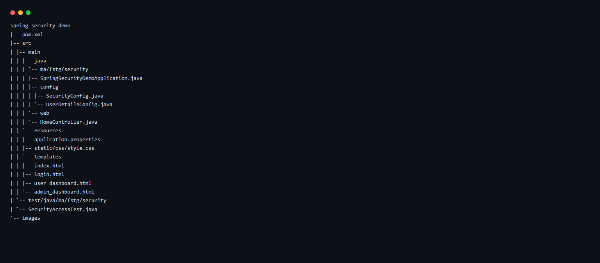
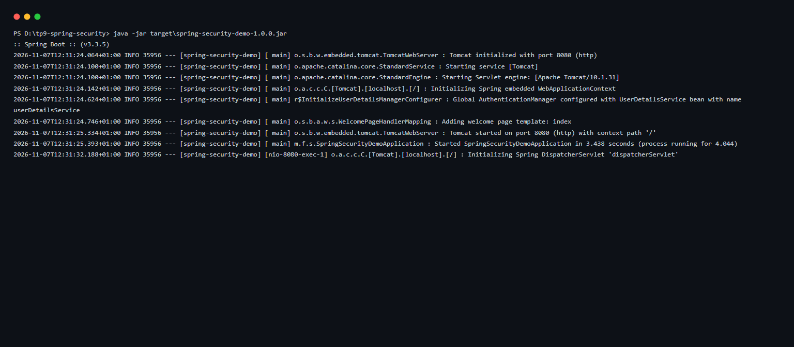
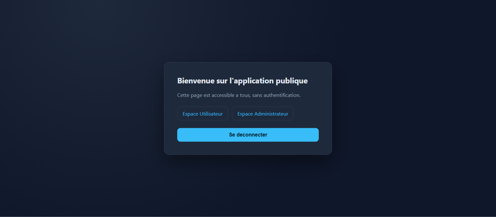
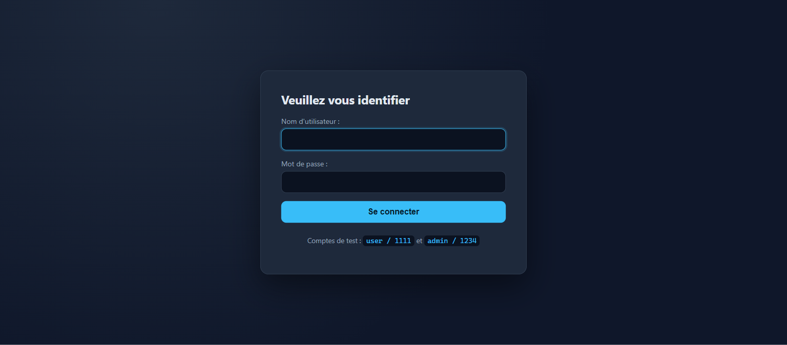
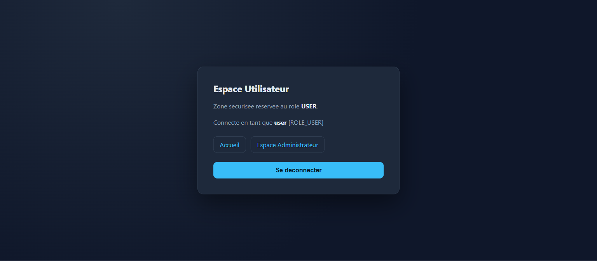
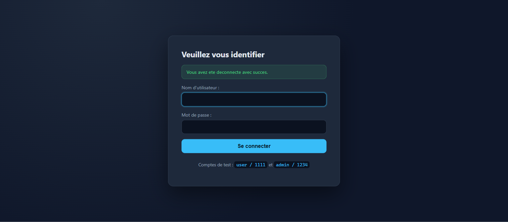
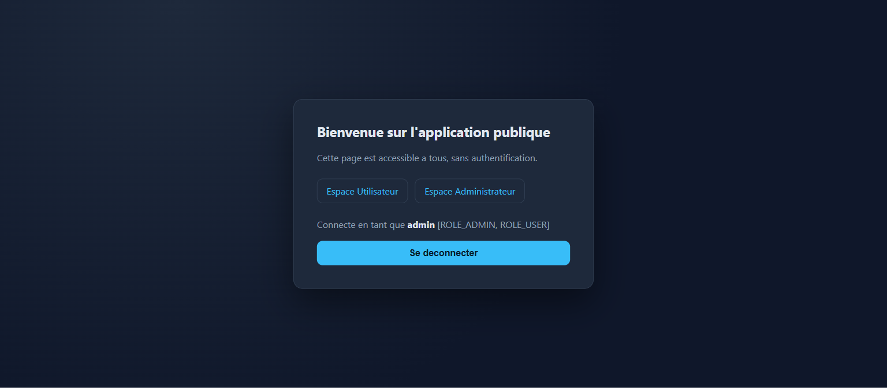
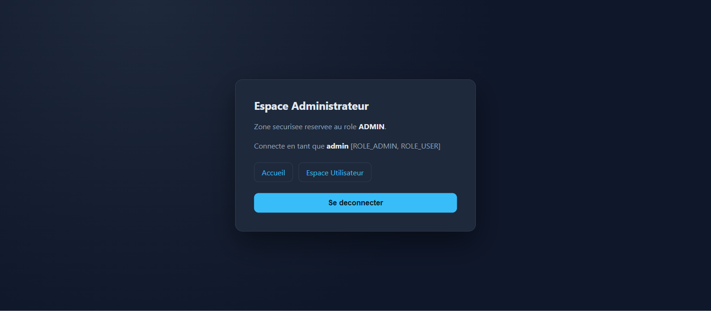
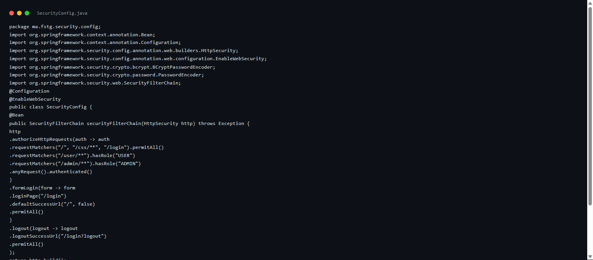
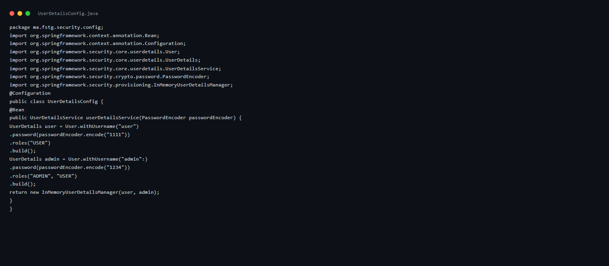

# TP 9 : Authentification en mémoire avec Spring Security

## Structure du projet

## Démarrage de l'application

## Page d'accueil accessible sans authentification

## Redirection vers la page de connexion personnalisée

## Tableau de bord de l'utilisateur authentifié

## Accès refusé pour un utilisateur sans le rôle ADMIN

## Déconnexion avec message de confirmation

## Page d'accueil après authentification

## Tableau de bord administrateur

## Configuration de la chaîne de filtres de sécurité

## Utilisateurs déclarés en mémoire avec mots de passe BCrypt

## Tests d'intégration de la sécurité

